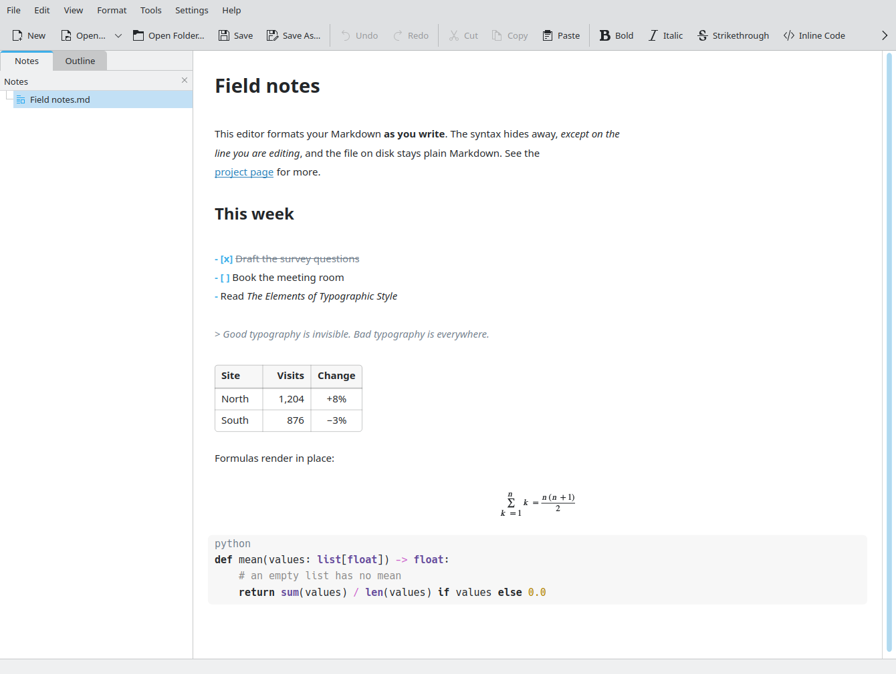

# Kalamus

A Markdown editor for KDE Plasma that formats your text as you write, in the spirit of
Typora, but free software (GPL-3.0-or-later) and built natively with Qt 6 and KDE Frameworks 6.

Named after the *calamus*, the reed pen scribes wrote with.



## Principles

- **Your file is the truth.** The editor shows the Markdown source styled like the
  finished page. It never rewrites your Markdown behind your back.
- **Syntax gets out of the way.** Markers such as `#`, `**` and `[](url)` are hidden
  except on the line you are editing.
- **KDE first.** Breeze colours, Plasma fonts, KXmlGui menus/toolbars/shortcuts,
  single-click setting, standard dialogs.

## Build

```bash
scripts/install-deps.sh          # once, needs sudo
cmake -B build -G Ninja -DCMAKE_BUILD_TYPE=Debug
cmake --build build
QT_QPA_PLATFORM=offscreen ctest --test-dir build   # tests
./build/bin/kalamus [file-or-folder]

# Install for your user (app menu entry + `kalamus` on PATH); re-run after rebuilding
cmake -B build -DCMAKE_INSTALL_PREFIX=$HOME/.local   # once
cmake --install build
```

The first configure downloads JKQtPlotter (pinned commit, see `3rdparty/CMakeLists.txt`);
only its LaTeX math renderer is compiled in.

## Third-party code

- **JKQTMathText** from [JKQtPlotter](https://github.com/jkriege2/JKQtPlotter), LGPL-2.1-or-later
- **XITS math fonts** (bundled with JKQTMathText), SIL Open Font License 1.1
- **cmark-gfm**, BSD-2-Clause (system library)

## Shortcuts

| Keys | Does |
|---|---|
| Ctrl+B / Ctrl+I | Bold / italic (wraps the selection, or toggles it off) |
| Alt+Shift+5 | Strikethrough |
| Ctrl+Shift+\` | Inline code |
| Ctrl+Shift+K | Code block (asks for the language) |
| Ctrl+K | Link |
| Ctrl+1 … Ctrl+6, Ctrl+0 | Heading level, paragraph |
| Enter in a list or quote | Continues it; Enter on an empty item ends it |
| Tab / Shift+Tab in a list | Indent / outdent the item |
| Shift+Enter | Plain new line |
| Ctrl+Shift+O | Open folder in the Files panel |
| F9 | Show/hide the Files panel |
| Shift+F9 | Show/hide the Outline panel (click a heading to jump to it) |
| Ctrl+Shift+, | Settings |
| Shift+F7 | Spell checking on/off (right-click a word for suggestions) |
| Ctrl+F / Ctrl+R | Find / find and replace (bar under the page; Esc closes) |
| F3 / Shift+F3 | Next / previous match |
| Ctrl+E | Export to PDF |
| Ctrl+T | Insert a table |
| Ctrl+Shift+I | Insert an image (or paste one, or drop image files) |
| Tab / Shift+Tab in a table | Next / previous cell (Tab past the last cell adds a row) |
| Enter in a table | New row below; Enter on an empty last row leaves the table |

## Roadmap

### v1
- [x] Live-formatted editing (headings, emphasis, code, links, lists, tasks, quotes);
      `#` and underlined (`===` / `---`) headings; emphasis and code may span lines
- [x] Files panel (folder tree, Markdown files only)
- [x] Export: HTML, PDF (built in, code blocks in color); Word, ODT (via pandoc)
- [x] Tables drawn as a grid when the cursor is outside; aligned source with
      spreadsheet-style keys inside; Table menu and right-click actions
- [x] Math: `$…$` and `$$…$$` drawn as formulas (JKQTMathText) when the cursor is
      elsewhere, LaTeX source when it's in them; broken formulas get a red underline;
      exported as KaTeX in HTML and as images in PDF
- [x] Images drawn in place (local, web, data:), scaled to the text width; linked
      badges too; missing files get a red underline; fitted to the page in PDF
- [x] Code blocks coloured by KSyntaxHighlighting (Kate's engine, 300+ languages,
      Breeze light/dark), full-width background, fences hidden outside the block
- [x] Spell checking (Sonnet): prose only, never code, math, links or paths;
  suggestions, Add to Dictionary and Ignore on right-click; Tools → Spelling Language
- [x] Outline panel: headings as a tree next to Files; click to jump, the
  current section is highlighted
- [x] Find and replace: live search, match count, match case / whole words /
  regex (with \1 in replacements), Replace All as one undo step
- [x] Recent files (File → Open Recent; moved or deleted files drop off), also listed in Plasma's Recent Files
- [x] Paste images into an `assets/` folder; drop image files (copied into assets/
      when they live outside the document's folder); Insert Image
- [x] Settings (Settings → Configure Kalamus): color scheme, text and code fonts,
  reading width, spelling, loading images from the web

### Later
- Focus / typewriter mode, word count
- Mermaid diagrams, KIO remote files, Flatpak
